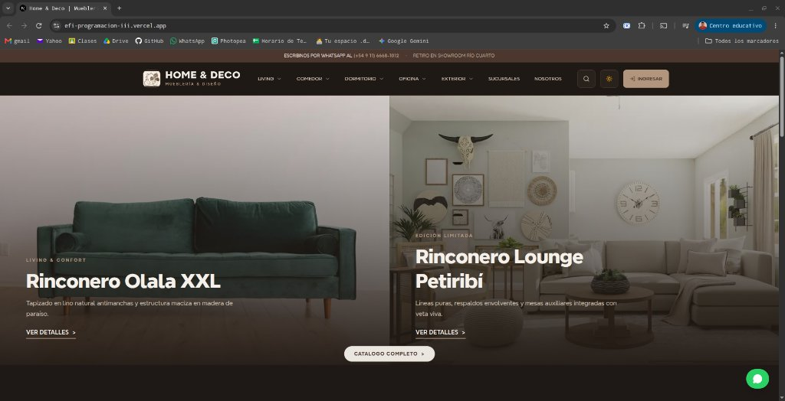
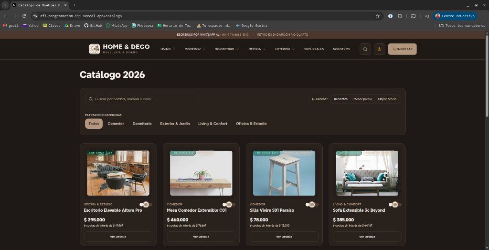
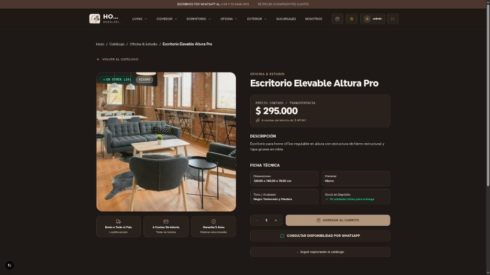
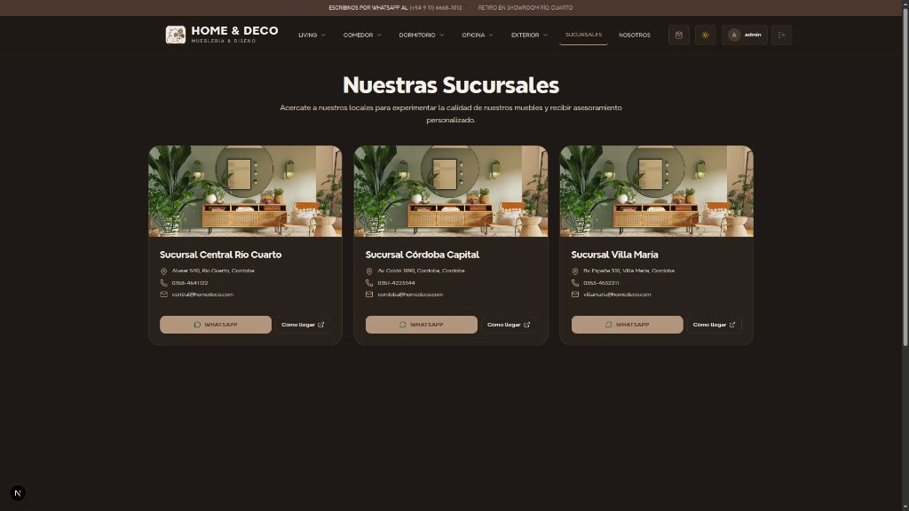
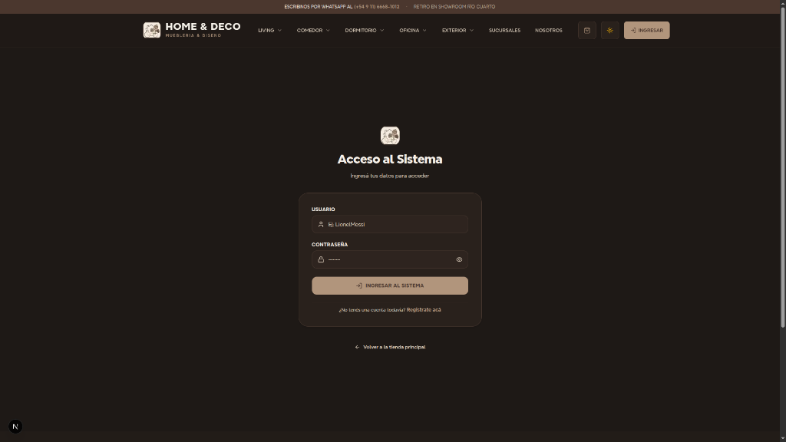
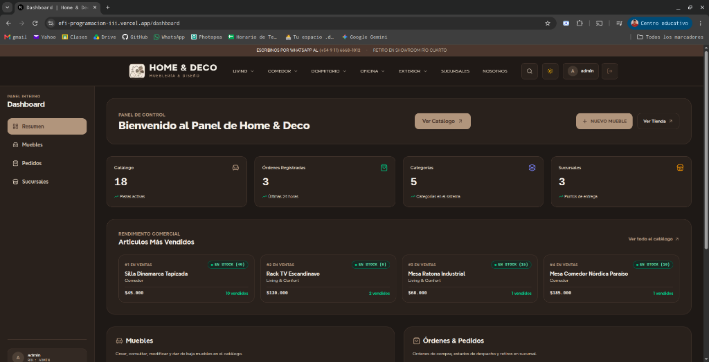

# 🪑 Home & Deco — Mueblería & Diseño de Interiores

> **Efi 2026**  
> **Carrera:** Tecnicatura Superior en Desarrollo de Software — ITEC Río Cuarto  
> **Cátedra:** Programación III   

---

## 📌 1. Descripción

**Home & Deco** es una plataforma web de comercio electrónico y gestión comercial para una mueblería. La marca se especializa en la fabricación y comercialización de piezas en maderas (*Paraíso, Petiribí y Pino Macizo*), con punto de venta y showroom físico en la ciudad de **Río Cuarto, Córdoba**.

La aplicación frontend fue desarrollada en **Next.js 16 ** y consume la API REST desarrollada para la cátedra de Ingeniería de Software.

### 🔗 Enlaces del Backend y Documentación
* **Repositorio Backend (Ing. de Software):** [GitHub - EFI-IngenieriaDeSoftware](https://github.com/IvanDanielEscobar/EFI-IngenieriaDeSoftware)
* **API Base URL (Producción en Render):** `https://homedeco-backend.onrender.com/api`

* **Endpoints:**
  - `POST /api/token/` y `POST /api/token/refresh/`: Autenticación JWT (SimpleJWT).
  - `POST /api/registro/` (y `/api/auth/registro/`): Registro público de clientes en la tienda con creación automática de usuario (rol `CLIENTE`), perfil y retorno de tokens JWT.
  - `GET /api/muebles/`, `POST /api/muebles/`, `GET /api/muebles/{id}/`, `PATCH /api/muebles/{id}/`, `DELETE /api/muebles/{id}/`: CRUD y listado con búsqueda y filtros.
  - `GET /api/muebles/destacados/`: Muebles con mayor volumen de venta.
  - `GET /api/categorias/`: Categorías de ambientes (*Living, Comedor, Dormitorio, Home Office*).
  - `GET /api/materiales/`: Tipos de madera y materiales.
  - `GET /api/pedidos/` y `DELETE /api/pedidos/{id}/`: Consulta y gestión de órdenes de compra.
  - `GET /api/sucursales/`: Showrooms y puntos logísticos de retiro.

---

## 🚀 2. Enlaces del Proyecto

| Recurso | Enlace |
|---|---|
| 🌐 **Aplicación Desplegada (Frontend)** | [efi-programacion-iii.vercel.app](https://efi-programacion-iii.vercel.app) |
| 📋 **Tablero de Gestión Ágil (Kanban)** | [GitHub Projects - Tablero EFI Home & Deco](https://github.com/users/IvanDanielEscobar/projects/13) |
| ⚙️ **API REST (Backend)** | [https://homedeco-backend.onrender.com/api](https://homedeco-backend.onrender.com/api) |

---

## 👥 3. Integrantes del Equipo

* **Iván Daniel Escobar** — `ivanescobar.tfr@gmail.com`
* **Jonatan Villavicencio** — `j.villavicencio@itecriocuarto.org.ar`
* **Matías Ibarra** — `m.ibarra@itecriocuarto.org.ar`
* **Santiago Garay** — `s.garay@itecriocuarto.org.ar`

---

## 🛠️ 4. Tecnologías y Arquitectura

* **Framework:** Next.js 16.4.3
* **Estilos:** Tailwind CSS v4 
* **Formularios:** React Hook Form v7 (Login, Registro y Gestión de Muebles)
* **Validación de Esquemas:** Zod v4 + `@hookform/resolvers` (`loginSchema`, `registerSchema`, `muebleSchema`)
* **Estado Global:** React Context API (`AuthContext`, `ThemeContext`, `CartContext`, `ToastContext`)
* **Testing:** Vitest v5 + `@testing-library/react` + JSDOM
* **Iconos:** Lucide React
* **Autenticación:** JWT (JSON Web Tokens)
* **Seguridad:** Middleware de protección de rutas y control de roles (`ADMIN`, `EMPLEADO`, `CLIENTE`)

---

## 💻 5. Instalación y Ejecución Local

### Prerrequisitos
- **Node.js:** versión 18.18.0 o superior.
- **npm:** versión 9 o superior.

### Clonar el repositorio
```bash
git clone https://github.com/IvanDanielEscobar/EFI-ProgramacionIII.git
cd EFI-ProgramacionIII
```

### Instalar dependencias
```bash
npm install
```

### Configurar variables de entorno
Crear un archivo `.env.local` en la raíz del proyecto:

```env
# URL base de la API REST de Django (desplegada en Render o local)
NEXT_PUBLIC_API_URL=https://homedeco-backend.onrender.com/api
```

*(Si se ejecuta el backend localmente en Django, utilizar `http://localhost:8000/api`)*

### Iniciar el servidor de desarrollo
```bash
npm run dev
```

Abrir [http://localhost:3000](http://localhost:3000) en el navegador.

### Compilación para Producción (Build)
```bash
npm run build
npm run start
```

---

## 🧪 6. Ejecución de Tests

Para correr los tests configurados con Vitest:

```bash
npm run test
```

Para correr los tests en modo observador (watch mode):
```bash
npx vitest
```
---

## 🔑 7. Usuarios de Prueba del Sistema 

Para probar la autenticación y las rutas protegidas del panel administrativo:

| Rol | Usuario | Contraseña | Permisos |
|---|---|---|---|
| 👑 **Superadmin** | `admin` | `admin123` | Acceso total al Dashboard, CRUD de muebles, pedidos y configuración |
| 💼 **Empleado (Vendedor)** | `vendedor1` | `vendedor123` | Acceso al Dashboard, gestión de muebles y consulta de órdenes |
| 👤 **Cliente** | `cliente_juan` | `cliente123` | Acceso exclusivo a navegación y catálogo de tienda (bloqueado para Dashboard) |

---

## 📸 8. Capturas de la Aplicación en Funcionamiento

### 1. Inicio / Landing Page (Home)



### 2. Catálogo de Muebles & Decoración



### 3. Detalle de Producto


### 4. Showroom & Sucursales


### 5. Formulario de Login 


### 6. Dashboard Administrativo 


---

## 🌿 9. GitFlow

El proyecto se gestionó bajo la metodología ágil **Kanban** mediante GitHub Projects, siguiendo el flujo de trabajo **GitFlow**:
* `main`: Rama de producción estable.
* `develop`: Rama de integración continua.
* `feature/*`: Ramas de características individuales para cada issue asignada:
  - `feature/inicializacion-tailwind`: Paleta de colores e identidad visual.
  - `feature/context-api`: Contextos globales de Tema y Autenticación.
  - `feature/layouts`: Estructura de layouts y componentes de navegación.
  - `feature/vistas-principales`: Implementación de páginas y rutas principales.
  - `feature/formulario-login`: Formulario de login con RHF y Zod.
  - `feature/formulario-muebles`: Formulario de alta/edición de muebles con medidas en cm.
  - `feature/consumo-de-api`: Integración con endpoints y servicios HTTP.
  - `feature/proteccion-rutas`: Middleware de seguridad y control de acceso.
  - `feature/ruta-dinamica`: Rutas dinámicas de detalle (`/catalogo/[id]`) y anidada (`/catalogo/categorias`).
  - `feature/config-produccion`: Configuración de despliegue en Vercel y cabeceras de seguridad HTTP.
  - `feature/carrito-y-registro`: Carrito de compras (`CartContext`, `CartDrawer`), notificaciones (`ToastContext`), soporte de imágenes en muebles y formulario de registro.
  - `documentacion/readme`: Documentación técnica, capturas y guía de entrega.

---

